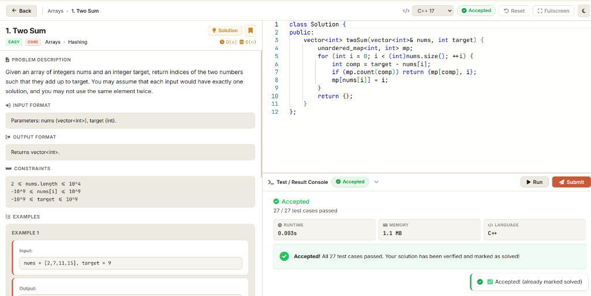
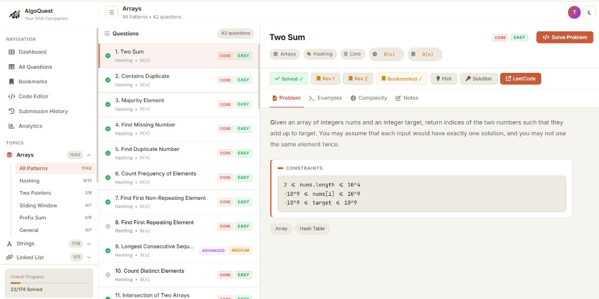
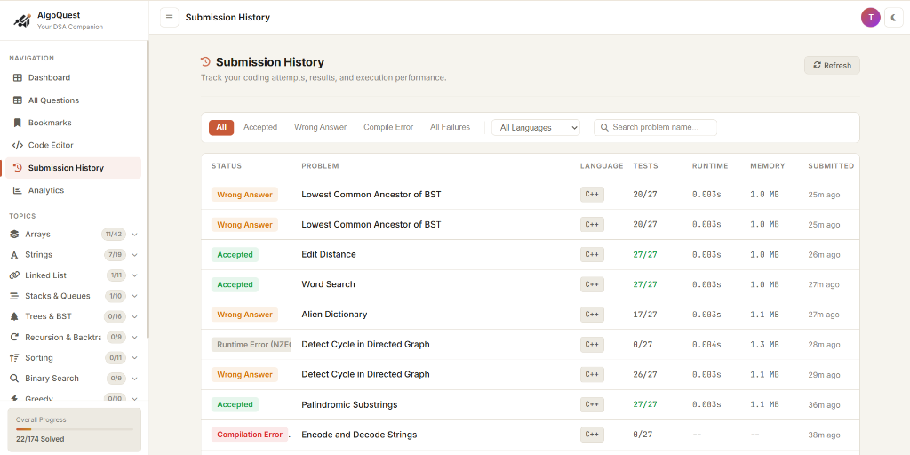
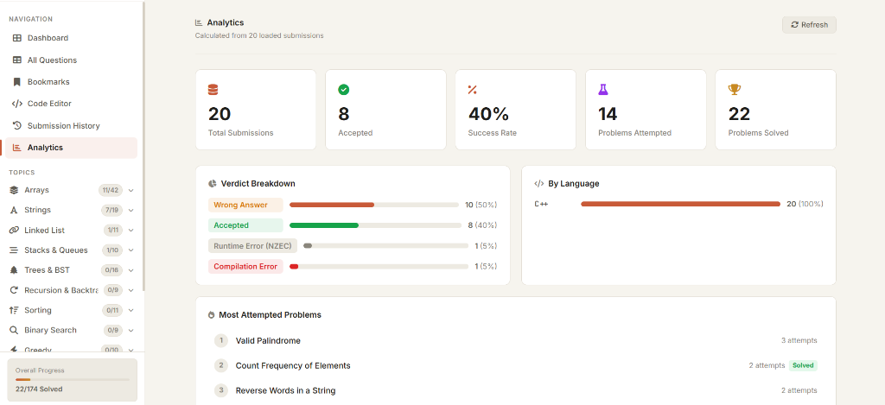

# AlgoQuest

> A full-stack, placement-focused DSA practice platform with in-browser code execution, asynchronous submission processing, real-time progress synchronization, and detailed performance analytics.

[](https://github.com/Yuvaraj-ui132/AlgoQuest/actions/workflows/ci.yml)
[](https://fastapi.tiangolo.com/)
[](https://www.python.org/)
[](https://developer.mozilla.org/en-US/docs/Web/JavaScript)
[](https://supabase.com/)
[](https://firebase.google.com/)
[](https://www.docker.com/)
[](LICENSE)

---

## 📌 Overview

**AlgoQuest** is a comprehensive DSA (Data Structures & Algorithms) preparation platform engineered to streamline technical interview practice into a single unified workspace. Instead of context-switching between problem sheets, code editors, and tracking spreadsheets, AlgoQuest combines a curated curriculum of **174 coding problems**, a **Monaco-powered IDE**, **Judge0 multi-language execution**, and **real-time progress sync**.

The platform is architected as a decoupled full-stack application: a lightweight Vanilla JS Single Page Application (SPA) on the frontend backed by a high-performance **FastAPI** backend that manages asynchronous submission queues, Judge0 remote execution, server-side hidden test verification, and per-user data isolation via Firebase ID tokens.

---

## 📸 Screenshots

| Code Workspace & Monaco Editor | Filterable Problem Catalogue |
| :---: | :---: |
|  |  |
| *Embedded Monaco IDE with C++17 solution, problem description, and console* | *Curated 174-problem bank across 14 DSA topics with tags and progress* |

| Submission History & Verdicts | Telemetry & Performance Analytics |
| :---: | :---: |
|  |  |
| *Submission history ledger displaying execution verdicts, test counts, and runtime* | *Aggregated performance analytics with success rate, verdict, and language breakdown* |

---

## 🏗️ System Architecture

```mermaid
flowchart TD
    subgraph Client["Frontend (Local Browser)"]
        UI[AlgoQuest SPA - Vanilla JS]
        Monaco[Monaco Code Editor]
        Auth[Firebase Client Auth]
    end

    subgraph Backend["FastAPI Backend Service"]
        API[FastAPI Router & Security]
        AuthCheck[Firebase ID Token Verifier]
        RateLimit[In-Memory Rate Limiter]
        Queue[Submission Queue - Memory / PG]
        Worker[Background Submission Worker]
    end

    subgraph External["Cloud & Execution Services"]
        Judge0[Judge0 CE API]
        DB[(Supabase PostgreSQL / Cloud Firestore)]
    end

    UI -->|1. Authenticate| Auth
    UI -->|2. Synchronous Run| API
    UI -->|3. Asynchronous Submit| API

    API --> AuthCheck
    AuthCheck --> RateLimit
    
    API -->|Run: Immediate Sample Test Execution| Judge0
    RateLimit -->|Submit: Enqueue Job & Return HTTP 202| Queue
    
    Queue --> Worker
    Worker -->|Fetch Hidden Tests & Execute| Judge0
    Worker -->|Write Submission Record & Update Solved| DB
    
    UI -->|4. Poll Job Status /api/submissions/{job_id}| API
    API -->|Read User Progress & History| DB
```

---

## ✨ Features

- **Curated Problem Bank**: 174 algorithmic problems categorized across Core and Advanced topics (Arrays, Two Pointers, Trees, Graphs, Dynamic Programming, and more).
- **Professional Code Workspace**: Embedded Microsoft Monaco Editor with multi-language support (**C, C++17, Java 17, Python 3, JavaScript ES6+**), syntax highlighting, and customizable keybindings.
- **Dual Execution Engine**:
  - **Run Code (Synchronous)**: Executes user code against visible sample test cases with instant stdin/stdout feedback.
  - **Submit Solution (Asynchronous)**: Validates against full hidden test suites via an async worker queue returning HTTP 202 with non-blocking client polling.
- **Dual-Mode Queue Architecture**:
  - **In-Memory Queue**: Non-blocking `asyncio.Queue` worker pool for lightweight single-container operation.
  - **Durable PostgreSQL Queue**: Reliable queue persisting jobs in PostgreSQL with `FOR UPDATE SKIP LOCKED` concurrency, lease heartbeats, and orphan recovery (`QUEUE_ENABLE_PG_BACKEND=true`).
- **Hidden Test Case Protection**: Hidden test inputs and expected outputs are stored strictly server-side and never exposed to the client.
- **Submission History & Analytics**: Tracks execution runtime, memory consumption, language breakdowns, success rates, and verdict histories.
- **Authentication & Security**: Email/password and Google OAuth via Firebase Authentication, with cryptographically verified RS256 JWT tokens and strict UID-isolated database models.
- **Per-User Rate Limiting**: Token-bucket rate limiting (10 submissions / 60 seconds) prevents API abuse.
- **Warm Graphite UI**: Modern developer workspace design with dark/light themes and responsive layout.

---

## 🛠️ Tech Stack

| Component | Technology | Description |
|---|---|---|
| **Frontend** | HTML5, Vanilla CSS, JavaScript (ES6+) | Frameworkless SPA optimized for speed and low overhead |
| **Code Editor** | Monaco Editor CDN | Microsoft VS Code editing engine |
| **Backend** | FastAPI (Python 3.11) | Async REST API with Pydantic v2 validation |
| **Task Queue** | `asyncio.Queue` & PostgreSQL 16 | Dual-mode queue: in-memory or durable with `FOR UPDATE SKIP LOCKED` |
| **Code Execution** | Judge0 CE (RapidAPI) | Multi-language containerized compiler engine (C, C++, Java, Python, JS) |
| **Database** | Supabase PostgreSQL / Cloud Firestore | Modular storage layer supporting PostgreSQL and Firestore via `db_service.py` |
| **Authentication** | Firebase Admin SDK + Firebase Auth | Server-side RS256 token verification and session management |
| **Containerization**| Docker & Docker Compose | Non-root container deployment with multi-stage builds |

---

## 📂 Project Structure

```
AlgoQuest/
├── index.html                   # Main application shell
├── css/style.css                # Warm Graphite design system & layout styles
├── js/                          # Frontend controllers (app, api, compiler, history, firebase)
├── data/                        # Questions bank (174 problems) & tier metadata
├── backend/
│   ├── app/                     # FastAPI core (routes, services, models, config)
│   ├── data/                    # Test cases and sample suites
│   ├── migrations/              # Flyway-style SQL migrations (V1, V2, V3)
│   ├── tests/                   # Automated test suite (239 tests passing)
│   ├── Dockerfile               # Production non-root container definition
│   └── requirements.txt         # Production Python dependencies
├── docker-compose.yml           # Local dev environment with PostgreSQL 16
├── firebase.json                # Firebase Hosting configuration
├── render.yaml                  # Render deployment configuration
├── LICENSE                      # MIT License
└── README.md
```

---

## 🚀 Getting Started

### Prerequisites
- Python 3.11+
- Node.js (v18+) or any static HTTP server
- A Firebase project with Authentication enabled
- A Judge0 CE API key (via RapidAPI or self-hosted)

### 1. Backend Setup

```bash
cd backend
python -m venv .venv
source .venv/bin/activate  # On Windows: .venv\Scripts\activate
pip install -r requirements.txt -r requirements-dev.txt

cp .env.example .env
# Configure JUDGE0_API_KEY, FIREBASE_PROJECT_ID, and database settings in .env

# Run full backend test suite
pytest tests/

# Start FastAPI development server
uvicorn app.main:app --reload --port 8000
```

FastAPI will start at `http://localhost:8000` (Swagger UI: `http://localhost:8000/docs`).

### 2. Frontend Setup

From the repository root:

```bash
# Start local static server
python -m http.server 5500
```

Open [http://localhost:5500](http://localhost:5500) in your browser.

### 3. Docker Compose (Full Stack)

```bash
cp .env.docker.example .env.docker
docker compose up --build
```

---

## 🔐 Environment Variables

| Variable | Description | Default | Required |
|---|---|---|---|
| `FIREBASE_PROJECT_ID` | Firebase Project ID | — | Yes |
| `GOOGLE_APPLICATION_CREDENTIALS` | Path to Firebase Admin service account JSON | — | Yes (local) |
| `FIREBASE_SERVICE_ACCOUNT_JSON` | Raw service account JSON string (for cloud) | — | Optional |
| `DATABASE_BACKEND` | Active storage layer: `firestore` or `supabase` | `firestore` | No |
| `SUPABASE_DB_URL` | PostgreSQL connection URL | — | If `supabase` |
| `QUEUE_ENABLE_PG_BACKEND` | Enable durable PostgreSQL queue (`SKIP LOCKED`) | `false` | No |
| `JUDGE0_API_KEY` | RapidAPI key for Judge0 CE | — | Yes |
| `JUDGE0_USE_RAPIDAPI` | Use RapidAPI host (`true`) or public (`false`) | `true` | Yes |
| `ALLOWED_ORIGINS_STR` | Comma-separated CORS allowed origins | Localhost origins | Yes |
| `SUBMISSION_WORKERS` | Concurrent background queue workers | `2` | No |

---

## 🧪 Testing

AlgoQuest includes a comprehensive automated test suite of **239 tests** (100% passing) across 13 test modules:

```bash
# Run full test suite
pytest backend/tests/
```

- **Unit & Security Tests**: Token verification, rate limiting, and CORS headers.
- **Queue Tests**: Concurrency, worker lease timeouts, heartbeats, backpressure, and orphan recovery.
- **PostgreSQL 16 Integration**: Multi-threaded concurrency testing directly against PostgreSQL using `FOR UPDATE SKIP LOCKED`.
- **Dataset Validation**: Input schema parsing, boundary cases, and whitespace preservation across all 174 problems.

---

## 📄 License

This project is licensed under the [MIT License](LICENSE).

---

## 👤 Author

**Yuvaraj Murkunde**  
- GitHub: [@Yuvaraj-ui132](https://github.com/Yuvaraj-ui132)
